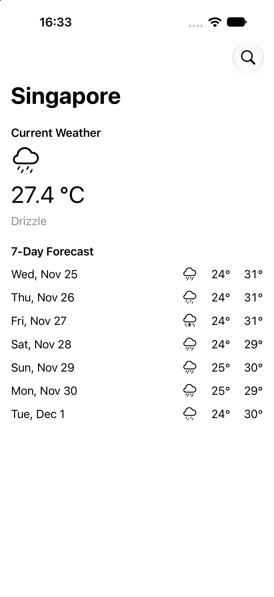
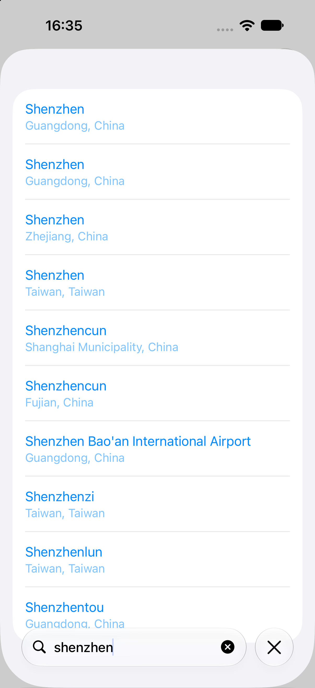
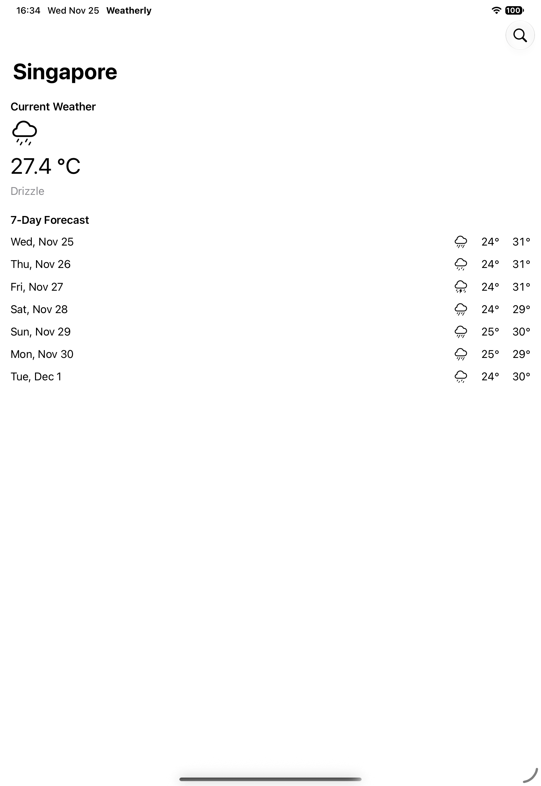
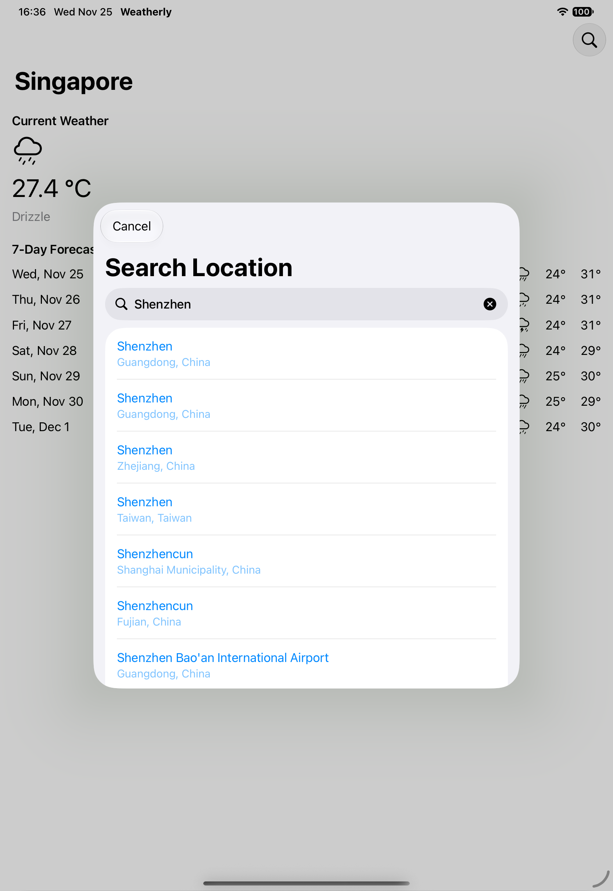
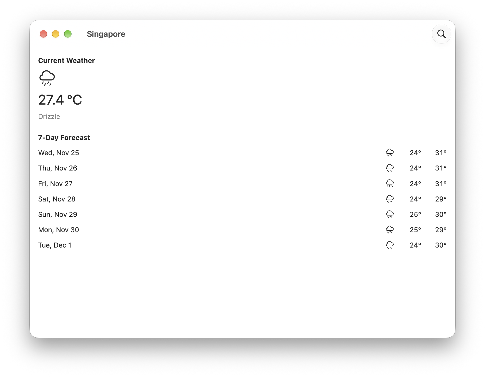
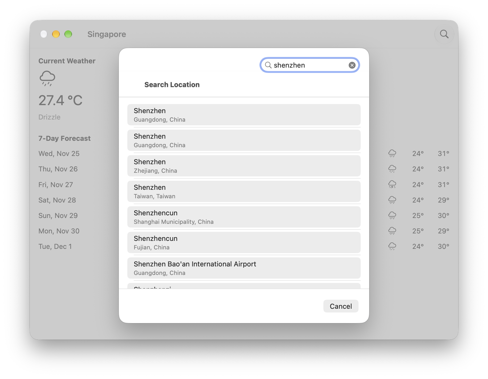

# 整体架构方案：

swift + swiftUI + MVVM + Clean Architecture

对于现在这个项目来说，可以使用layer First的架构，其实可以，也比较简单。但考虑到长期发展，以及业务增多的可能性，这里使用feature first的架构，这样也方便以后的团队合作。

## 环境与支持

| 项目       | 信息                |
| ---------- | ------------------- |
| 支持平台   | iPhone、iPad、macOS |
| Swift 版本 | Swift 5             |
| 最低 iOS   | 17.0                |
| 最低 macOS | 14.6                |

# 截图

| 平台 | 天气 | 搜索 |
| --- | --- | --- |
| iPhone |  |  |
| iPad |  |  |
| macOS |  |  |

## Code style guideline

严格遵守Swift的 style guideline，包括但不限于：
<https://www.swift.org/documentation/api-design-guidelines/>
实际的情况可以团队内部约定，扩展以及完善。
可以使用swiftLint来检查代码是否符合guideline。本项目未启用，避免评审时额外安装依赖。

## 功能与需求

- 搜索地点（支持输入防抖、取消过期请求）
- 查看当前天气
- 查看未来 7 天预报
- 加载中 / 错误（可重试）/ 空结果状态

## 非功能性要求

- 单元测试
- 天气api设计好，数据源可以随时替换，但不需要改动业务逻辑，即插即用。
- feature之间不能互相依赖
- 一些标准化的东西要组件化可复用，比如网络请求，UI组件等。
- 自适应布局（支持屏幕旋转）

## 可拓展性功能（将来可能要做）

- 多语言支持
- 定位当前位置天气。（需要权限流程和隐私说明）
- Appearance 支持。
- 是否需要缓存天气数据。
- 弱网的表现。

## 技术选型

- 天气api目前采用 Open-Meteo(<https://open-meteo.com)。方便demo设计，因为不需要key等。实际情况可能考虑比如Apple的weatherKit等。>

（注意： 如果涉及到使用api key一定要注意安全策略。不能放到代码仓库）

# Build & Run

1. 环境 Xcode 27.0
2. 打开Weatherly.xcodeproj, 选择 `Weatherly` scheme，Run
3. 不需要三方库，和额外配置。
4. 单元测试运行 Cmd + U

# CI & CD

- 使用 GitHub Actions， PR 到 `main` 时触发
- 内容：在 macOS 上运行单元测试，并编译 iOS Simulator 版本
- 发布：如后续需要分发，可用 fastlane 做签名与上传


# workflow

- 单人开发，使用Githubflow，不采用gitflow。
- `main` 分支始终保持可以编译测试通过。
- 一个分支开发一个功能，开发完成后合并到`main`分支命名使用`feature/`、`fix/`等前缀。

# 主要目录结构

以下为当前的核心文件结构。

```text
Weatherly/                          # 仓库根目录
├── Weatherly/                      # App 源码
│   ├── App/
│   │   ├── WeatherlyApp.swift      # 入口
│   │   ├── RootView.swift          # 根视图：天气页 + 搜索 sheet
│   │   └── AppContainer.swift      # 依赖装配点
│   ├── Features/
│   │   ├── Search/
│   │   │   ├── Data/
│   │   │   │   ├── DTOs/
│   │   │   │   │   └── GeocodingResponseDTO.swift
│   │   │   │   ├── Endpoint+Geocoding.swift
│   │   │   │   ├── LocationMapper.swift
│   │   │   │   └── OpenMeteoLocationRepository.swift
│   │   │   ├── Domain/
│   │   │   │   ├── LocationRepository.swift
│   │   │   │   └── SearchLocationUseCase.swift
│   │   │   └── Presentation/
│   │   │       ├── Components/
│   │   │       │   └── LocationRow.swift
│   │   │       ├── SearchLocationView.swift
│   │   │       └── SearchLocationViewModel.swift
│   │   └── Weather/
│   │       ├── Data/
│   │       │   ├── DTOs/
│   │       │   │   └── ForecastResponseDTO.swift
│   │       │   ├── Endpoint+Forecast.swift
│   │       │   ├── ForecastMapper.swift
│   │       │   └── OpenMeteoWeatherRepository.swift
│   │       ├── Domain/
│   │       │   ├── Models/
│   │       │   │   ├── Weather.swift
│   │       │   │   └── WeatherCondition.swift
│   │       │   ├── FetchWeatherUseCase.swift
│   │       │   └── WeatherRepository.swift
│   │       └── Presentation/
│   │           ├── Components/
│   │           │   ├── CurrentWeatherSection.swift
│   │           │   ├── DailyForecastSection.swift
│   │           │   └── WeatherContentView.swift
│   │           ├── Formatting/
│   │           │   └── ForecastDayFormatter.swift
│   │           ├── WeatherView.swift
│   │           └── WeatherViewModel.swift
│   ├── Core/
│   │   ├── Networking/
│   │   │   ├── Endpoint.swift
│   │   │   ├── HTTPClient.swift
│   │   │   ├── HTTPMethod.swift
│   │   │   └── URLSessionHTTPClient.swift
│   │   ├── Domain/
│   │   │   ├── AppError.swift
│   │   │   └── Location.swift
│   │   ├── Logging/
│   │   │   └── AppLogger.swift
│   │   └── UI/
│   │       ├── ViewState.swift
│   │       └── ErrorStateView.swift
│   └── Assets.xcassets/
└── WeatherlyTests/                 # 与 Features 镜像的测试
    └── Features/
       └── Weather/
           ├── Data/
           │   └── ForecastMapperTests.swift
           └── Presentation/
               └── Formatting/
                   └── ForecastDayFormatterTests.swift

```

### 依赖规则

App ──▶ Features ──▶ Core

Features: Presentation ──▶ Domain ◀── Data

- Feature 之间禁止互相引用，共享类型放 Core，由 App 层串联
- Domain 不依赖 UIKit / SwiftUI / URLSession
- 协议在 Domain，实现在 Data，由 AppContainer 注入
- MVVM 是界面层的架构，View 依赖 ViewModel，ViewModel 依赖 Domain

# 说明

- 单元测试：目前提供 `ForecastMapper`，`ForecastDayFormatter` 的测试作为示例，`ViewModel / Repository `的测试待补充。
- 缓存，定位，多语言这些都没有做。暗黑模式目前跟随系统，没有设计成菜单。
- 没有写XCUITest 如果有时间可以补充。
- iPad和mac OS的UI没有进一步优化，空间太大，可以考虑`horizontalSizeClass`方案来进一步优化，比如宽屏左右布局。
- `ErrorStateView` 放在了`Core`下面，代表可以被不同的feature 复用。
- 没有拆 `Swift Package`。目前工程规模小，项目过大之后比如日志，`Networking`部分可以写成`swift package`里面。这样项目更加清晰。

